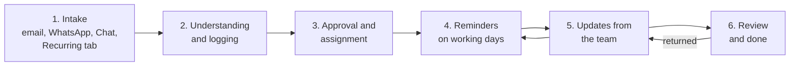
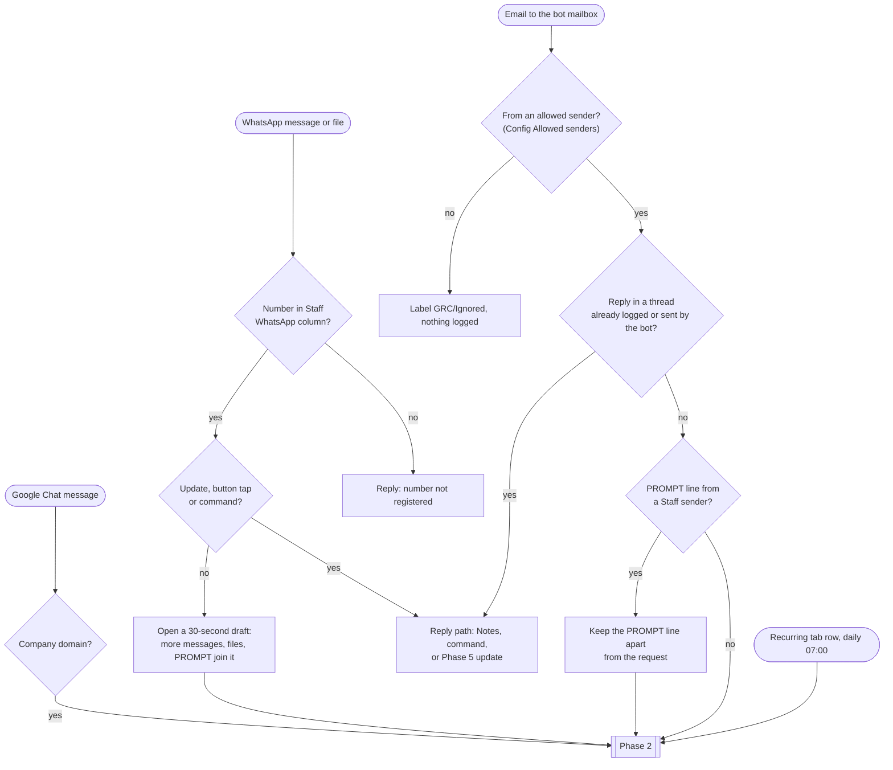
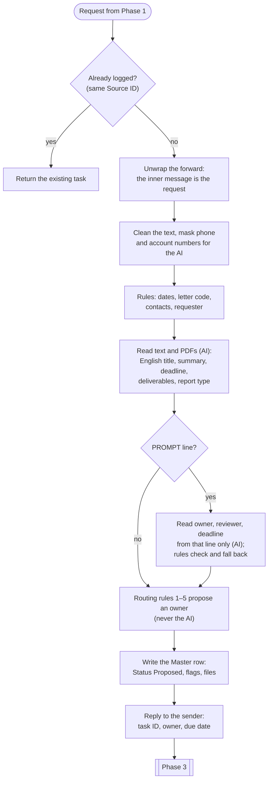
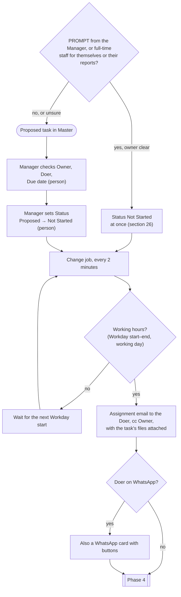
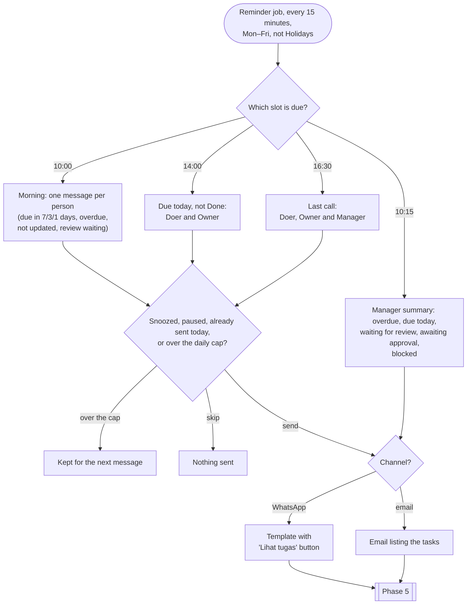
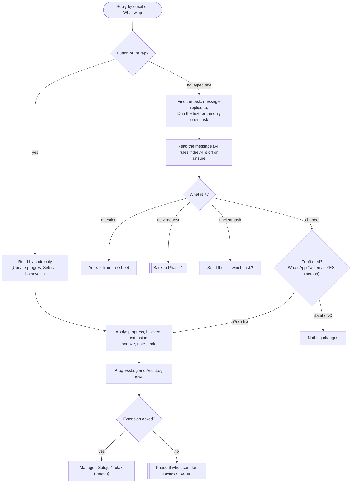
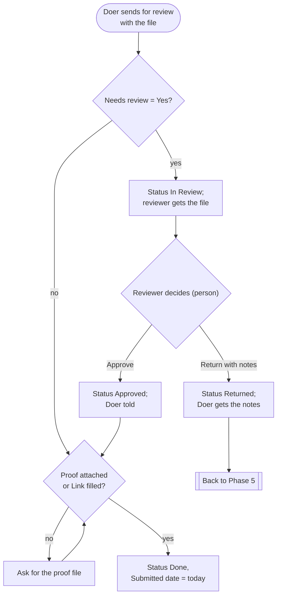

# How a request flows through the GRC Tracker

Six phases, from a request arriving to the task being done. The overview shows how they
connect; each phase then has its own diagram. Steps marked **(AI)** use Gemini; steps marked
**(person)** need someone to act. Every other step is fixed code. Names are examples
(`Staff A`), never real people.

## Overview

---

## Phase 1: Intake

- **Email** comes in within about a minute (Gmail push) or at the 10-minute backup run.
  Senders not in Config `Allowed senders` are ignored (DESIGN D16, section 20).
- A **reply** in a thread the bot already logged, or a reply to a bot email (reminder,
  notice), is never a new request: it goes to Notes or to Phase 5 (sections 20 and 22).
- **WhatsApp** only accepts numbers in the Staff `WhatsApp` column. A forwarded request opens a
  30-second draft so the sender can add files and a `PROMPT:` line (section 17).
- A **PROMPT line** (`PROMPT: assign this to Staff P, reviewer Staff D, deadline Friday`) only
  counts from a Staff sender, and only from the text they typed, never from a PDF (section 21).
- **Recurring tab** rows create their task a set number of days before each deadline, already
  approved (section 20).

---

## Phase 2: Understanding and logging

- **Rules first, AI second**: dates and letter codes are read by fixed rules; Gemini adds a
  readable title, a summary and the deadline from PDFs. With Config `AI provider` = `Off`, the
  rules do everything (section 6).
- **Routing** (section 5): rule 1 a known report's default owner, rule 2 its backup, rule 3 the
  least-loaded person in the division, rule 4 the AI's report type, rule 5 nobody
  (`Needs review: no owner`). A PROMPT's owner overrides the rules but is flagged.
- **Nothing is lost**: a failure leaves the email unread for the next run (D15).

---

## Phase 3: Approval and assignment

- A PROMPT from the Manager (or from full-time staff for themselves or their reports) starts the
  task at once; anything else, or a PROMPT the bot is unsure about, only **proposes** and waits
  for the Manager (sections 2 and 26). Interns and additional help cannot assign.
- The assignment email attaches the files from the bot mailbox (up to 20 MB), so the Doer gets
  the forwarded PDFs (v1.4 F4).
- Notices outside working hours wait in `_event_queue` until 10:00 on the next working day
  (section 22).

---

## Phase 4: Reminders on working days

- Times, holidays and the daily cap are Config settings, editable without a deploy
  (section 22).
- The same rule for the same task never reaches the same person twice in one day
  (`_reminders_sent`).
- WhatsApp is used when the person has a number and `WhatsApp opt-in`; if the send fails, the
  reminder goes by email.

---

## Phase 5: Updates from the team

- **Typed changes are never saved without confirmation**; button taps save at once
  (section 22, decision 2).
- The AI only reads the message and the person's own open tasks; it cannot invent a task or a
  date, and anything under 0.6 confidence goes to the rules.
- **Blocked** puts the task On Hold and tells the Owner and Manager; an **extension** changes
  the due date only when the Manager agrees; **snooze** pauses reminders up to 2 working days;
  **undo** reverses the person's last change within 24 hours.

---

## Phase 6: Review and done

- The **reviewer** is the task's Reviewer, else the Doer's full-time supervisor, else the
  Manager (section 19).
- **Done** needs proof: a file, or a `Link` already filled. The sheet's Apps Script undoes a
  hand-set Done without it.
- Done and Proposed tasks get no reminders.
